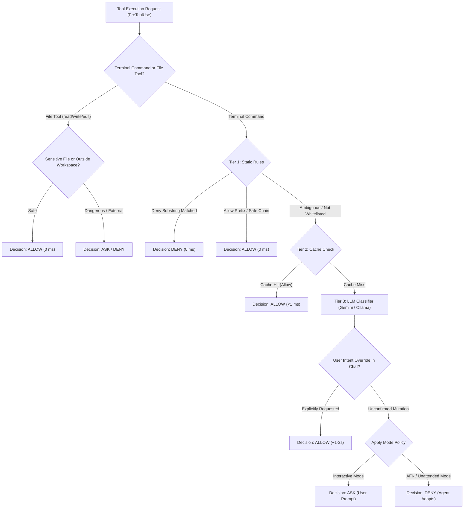

# agy-guard 🛡️

**Ultra-fast, zero-dependency security classifier and guardrail for [Antigravity CLI (`agy`)](https://github.com/google-deepmind).**

`agy-guard` runs as a native Antigravity plugin and PreToolUse hook. It intercepts shell commands and file operations, evaluates safety using a 3-tier hybrid engine (Static Whitelist/Blacklist -> Context Reader -> LLM Classifier), and enforces fail-safe verdicts (`allow`, `ask`, or `deny`).

---

## ⚡ Key Highlights

* ⚡ **Instant Pass (<1 ms, 0 API Calls):** 99.9% of everyday developer tools (`go`, `git`, `python3`, `npm`, `cargo`, `sed`, `awk`, `cat`, `ls`, `grep`, etc.) and safe compound chains (`git status && ls`) pass instantly in Tier 1 without touching an LLM.
* 📁 **Universal Tool & File Protection (0 ms):** Intercepts both terminal commands and file tools (`edit_file`, `write_file`, `read_file`).
  * **Read-only tools:** Safely allowed anywhere across your system for inspection/docs, while sensitive credentials (`.env`, `id_rsa`) remain strictly protected.
  * **Mutating tools:** Edits inside your workspace are allowed instantly; attempts to overwrite files outside workspace boundaries require explicit confirmation.
* 🛑 **Instant Block:** Dangerous system commands (`rm -rf /`, `git push -f`, `git reset --hard`, `sudo`, credential exfiltration) are rejected on the spot.
* 🤖 **Smart Intent Override (Tier 3 LLM):** If you tell the agent in chat *"push this commit"* or *"deploy now"*, the LLM reads recent conversation context and automatically approves operations like `git push` without interrupting you with confirmation dialogs.
* 🔄 **Antigravity CLI Dual-Gate Sync (`permissionOverrides`):** Automatically injects Antigravity permission grants on every `allow` decision and synchronizes standard dev commands into `~/.gemini/antigravity-cli/settings.json`, eliminating repetitive native CLI popups.
* 🔁 **Loop Breaker (Circuit Guard):** Detects repetitive blocked actions (Strike 2+) to break AI agent infinite loops. In AFK mode, it halts looping tasks with actionable stop-instructions.
* 🌙 **Autonomous / AFK Mode:** Switch to `unattended_mode: true` for hands-off overnight agent coding. Commands that would normally prompt the user fail safely with instructions to find alternative paths.
* 🛡️ **Fail-Closed & Fail-Safe:** Never crashes your CLI session (`pre-tool hook failed`). If an LLM times out or is unavailable, it safely falls back to manual confirmation (`ask`).

---

## 🚀 Quick Start

### 1-Line Interactive Installer

Run the installer in your terminal to download/compile the binary, configure execution mode (Interactive vs Autonomous AFK), select your AI model, and register the native Antigravity plugin:

**macOS & Linux:**
```bash
curl -fsSL https://raw.githubusercontent.com/agy-guard/agy-guard/main/install.sh | bash
```

**Windows (PowerShell):**
```powershell
irm https://raw.githubusercontent.com/agy-guard/agy-guard/main/install.ps1 | iex
```

*(Or execute `./install.sh` / `.\install.ps1` from a cloned repository)*

### Manual CLI Setup

If you build or install via Go:

```bash
# 1. Install or build
go install github.com/agy-guard/agy-guard/cmd/agy-guard@latest

# 2. Initialize config and register native Antigravity plugin
agy-guard init --plugin
```

---

## 🏛️ How It Works: The 3-Tier Pipeline



1. **Fast File Filter (0 ms):** Verifies file paths against workspace roots (`workspacePaths`, `cwd`) and protects credentials (`.env`, `hooks.json`, `~/.ssh/id_rsa`).
2. **Tier 1 Static Rules (0 ms):** Analyzes commands and compound chains (`&&`, `||`, `;`, `|`). If all parts match `allow_prefixes`, execution proceeds instantly with **zero API quota consumed**.
3. **Smart Cache (<1 ms):** Hashes command + dialogue context (10-minute TTL) so repeated commands in loops don't incur latency.
4. **Tier 3 LLM Evaluation (~1-2s):** Evaluates ambiguous commands with OS awareness (`runtime.GOOS`), extracting the user's latest request from `transcriptPath` to safely grant Intent Overrides.

---

## 🔍 Testing Any Command (`dry-run`)

Test how `agy-guard` evaluates commands directly from your terminal with exact latency metrics:

```bash
# Standard dev tool (passes Tier 1 instantly)
agy-guard dry-run "go test ./... && git status"

# Safe compound chain
agy-guard dry-run "ls -la | grep main"

# Blocked destructive command
agy-guard dry-run "rm -rf /tmp/data"

# Intent-dependent command
agy-guard dry-run "git push origin main"
```

Example output:
```text
[dry-run] Command: go test ./... && git status
[dry-run] Action Class: go test
[dry-run] Matched Tier: Tier 1 (Static Rules)
[dry-run] Latency: 194µs
[dry-run] Decision: allow
[dry-run] Reason: All 2 compound command parts matched Tier-1 safe prefixes
```

---

## ⚙️ Configuration Reference

Configuration is stored in `~/.agy-guard/config.json` (auto-generated on `agy-guard init`):

```json
{
  "provider": "gemini",
  "model": "gemini-3.5-flash",
  "api_key": "YOUR_GEMINI_API_KEY",
  "ollama_url": "http://localhost:11434",
  "timeout_sec": 15,
  "include_transcript_context": true,
  "enable_audit_log": true,
  "enable_cache": true,
  "cache_ttl_minutes": 10,
  "unattended_mode": false,
  "max_retries_before_ask": 2,
  "static_rules": {
    "allow_prefixes": [
      "go test", "go build", "go vet", "go run", "golangci-lint",
      "git status", "git diff", "git log", "git add", "git commit",
      "npm test", "npm run", "cargo check", "cargo test", "pytest",
      "ls", "cat", "head", "tail", "grep", "find", "sed", "awk", "python3"
    ],
    "deny_substrings": [
      ".env", "id_rsa", "gh auth token", "sudo ", "git push -f",
      "git reset --hard", "| sh", "| bash", "rm -rf /", ":(){ :|:& };:"
    ]
  }
}
```

### Execution Modes

* **Interactive Mode (`unattended_mode: false`):**  
  Standard developer mode. If a command modifies state or isn't pre-approved, `agy-guard` pauses and asks for user confirmation.
* **Autonomous / AFK Mode (`unattended_mode: true`):**  
  For unattended or overnight agent runs. `agy-guard` eliminates confirmation popups: commands requiring confirmation are converted to `deny` with an informative instruction for the agent to find an alternative approach or skip to the next step. Intent overrides given in chat remain fully operational.

### AI Provider Selection

* **Google Gemini (Default):**  
  Recommended model: `gemini-3.5-flash`. Fast response times (~1.5s) and accurate intent reasoning. Get a free API key at [aistudio.google.com](https://aistudio.google.com).
* **Local Ollama (100% Offline):**  
  Set `"provider": "ollama"`, `"model": "llama3.2"`, and `"ollama_url": "http://localhost:11434"`. No API key required; operates with complete privacy.

---

## 📝 Audit Logs

Every decision is recorded to `~/.agy-guard/audit/<session_id>.jsonl` with session ID, command, cwd, latency, tier, and justification.

To stream audit events in real time:
```bash
tail -f ~/.agy-guard/audit/*.jsonl | jq .
```

---

## 🗑️ Uninstallation

To remove `agy-guard` and restore default Antigravity CLI behavior:

### Via Script
```bash
# macOS / Linux
./uninstall.sh          # Unregisters hook and removes plugin (keeps logs/config)
./uninstall.sh --purge  # Completely removes ~/.agy-guard

# Windows (PowerShell)
.\uninstall.ps1
.\uninstall.ps1 -Purge
```

### Via CLI
```bash
agy-guard uninstall
# or purge configuration and audit logs:
agy-guard uninstall --purge
```

---

## 🧪 Testing & Verification

`agy-guard` is strictly built with the Go Standard Library (zero third-party dependencies):

```bash
# Run unit & race tests
go test -v -race ./...

# Run linters
go vet ./...
golangci-lint run
```

---

## 📄 License

MIT License.
